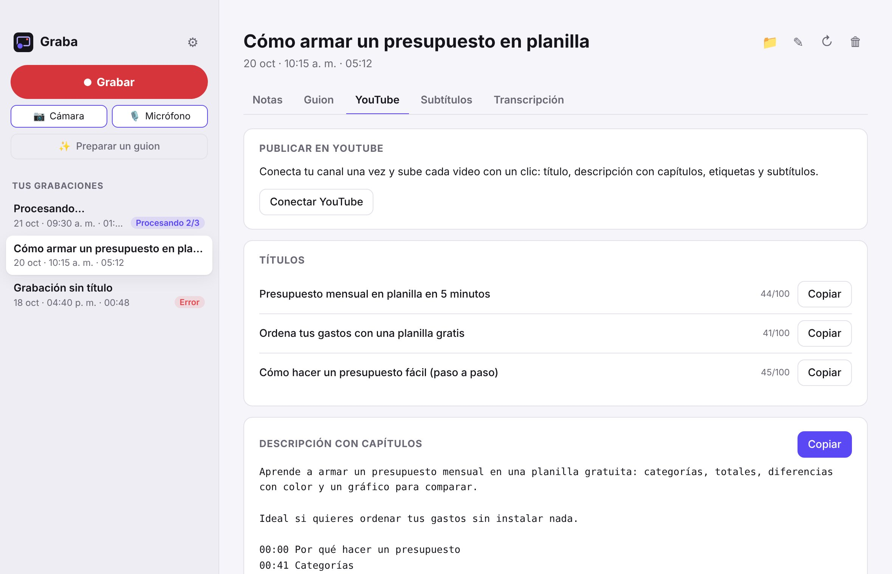

<p align="center"></p>

<h1 align="center">Graba</h1>

<p align="center"><b>Graba tu pantalla con tu cámara. Tu IA te deja notas, un guion para YouTube, títulos, descripción con capítulos y subtítulos.</b><br>
Gratis, open source y sin fines de lucro. Mac, Windows y Linux. Todo pasa en tu computador.</p>

<p align="center"><a href="https://github.com/graba-app/graba/releases/latest"><b>Descargar</b></a> · <a href="https://graba-app.github.io/graba/"><b>Página</b></a> · <a href="#instalar">Instalar</a> · <a href="https://github.com/graba-app/graba/discussions">Comunidad</a> · <a href="CONTRIBUTING.md">Cómo aportar</a> · <a href="#licencia--license">English</a></p>

<p align="center"><picture><source srcset="docs/img/app-oscuro.jpg" media="(prefers-color-scheme: dark)"></picture></p>

---

## Qué hace

1. **Prepara el guion (opcional):** le cuentas a tu IA la idea, cuánto debe durar y le sumas tu presentación (PDF, PowerPoint, Word…).
   Te escribe lo que vas a decir, con el largo justo.
2. **Grabas** toda la pantalla, una ventana, un área o **solo la cámara**, con tu cámara (círculo, cuadrada, horizontal o vertical, del
   tamaño que quieras) y tu voz, eligiendo qué cámara y qué micrófono usar, y si quieres **el sonido del Mac** (o del computador en
   Windows). Puedes **pausar y reanudar** sin que quede un hueco. El **teleprompter** avanza solo y no sale en el video, igual que la
   barra de controles. **Atajos globales:** ⌃⌥⌘R empieza o termina y ⌃⌥⌘P pausa (Ctrl+Alt+Shift+R / P en Windows y Linux).
3. **Transcribe en tu computador** con whisper.cpp. Nada se sube a ningún servidor.
4. **Tu propia IA** (Claude Code, Codex o Gemini/Antigravity, con tu cuenta) escribe:
   - **Notas:** resumen y puntos clave.
   - **Guion para YouTube:** gancho, introducción, desarrollo con indicaciones de qué mostrar y cierre (y lo puedes mandar al teleprompter para regrabar).
   - **Para publicar:** 3 títulos, descripción con **capítulos** (con tiempos reales, el primero en 00:00 como pide YouTube) y etiquetas.
   - **Subtítulos** `.srt` listos para subir.
5. **Recortas el inicio y el final** («eh… ya, ¿se escucha?»): la transcripción, los subtítulos y los capítulos se corren solos y el
   original queda guardado para volver a él.
6. **Corriges con tus palabras** ("dice Grava y es Graba"): tu IA lo arregla en todo, también en los subtítulos, y lo aprende.
7. **Directo a YouTube** (en camino): conectas tu canal y se sube con título, capítulos, etiquetas y subtítulos, o solo al terminar.

Todo queda en `~/Graba`, una carpeta por grabación, en archivos normales que puedes abrir, copiar o usar en tus propios scripts.
Graba se **actualiza sola**: revisa al abrirse y cada 6 horas, y te avisa dentro de la app.

### Open source y sin fines de lucro

Graba no es una empresa: no hay versión de pago, anuncios, inversionistas ni datos que vender. Es gratis para siempre, el código es
abierto (MIT) y la hacemos entre todos. ¿Quieres sumarte? Mira [CONTRIBUTING.md](CONTRIBUTING.md).

## Instalar

**Mac** (chip Apple, macOS 15 o posterior), en la Terminal:

```bash
curl -fsSL https://raw.githubusercontent.com/graba-app/graba/main/instalar.sh | bash
```

O descarga [`Graba-macOS.zip`](https://github.com/graba-app/graba/releases/latest/download/Graba-macOS.zip), arrástrala a Aplicaciones y,
si macOS dice que no pudo verificarla (aún no está firmada por Apple): Ajustes del Sistema → Privacidad y seguridad → **Abrir igualmente**.

**Windows y Linux** (la misma interfaz):

| | Con un comando | Descargando |
|---|---|---|
| 🪟 **Windows** | `irm https://raw.githubusercontent.com/graba-app/graba/main/instalar.ps1 \| iex` (PowerShell) | [`Graba-Windows.exe`](https://github.com/graba-app/graba/releases/latest/download/Graba-Windows.exe): si aparece «Windows protegió tu PC», **Más información → Ejecutar de todas formas** |
| 🐧 **Linux** | `curl -fsSL https://raw.githubusercontent.com/graba-app/graba/main/instalar.sh \| bash` (sin sudo) | [`Graba-Linux.AppImage`](https://github.com/graba-app/graba/releases/latest/download/Graba-Linux.AppImage) (necesita FUSE: `sudo apt install libfuse2`) |

Los comandos bajan la última versión, verifican su huella SHA-256, la instalan solo para tu usuario y la abren. Windows 10 u 11 de
64 bits; Linux x86_64 (Ubuntu 18.04+, Debian, Fedora…). No hace falta Python ni ffmpeg: vienen dentro de la app. Ahí la transcripción
usa el procesador (sin tarjeta gráfica), así que el modelo «Liviano» es el recomendado para la mayoría. En Windows la barra de controles
no sale en el video; en Linux sí (no hay cómo ocultarla) y, con Wayland, el sistema pregunta qué pantalla compartir
([ayúdanos a probarla](https://github.com/graba-app/graba/issues)).

La primera vez, Graba te ayuda a elegir tu IA ([cómo instalarla](https://graba-app.github.io/graba/ia.html)), descarga el transcriptor
(una sola vez) y pide los permisos de pantalla, cámara y micrófono.

## Formato de las grabaciones

```
~/Graba/
  2026-10-20 1015 - Cómo armar un presupuesto/
    video.mp4            # pantalla + burbuja de la cámara + micrófono (H.264 / AAC)
    grabacion.md         # todo el texto (abajo)
    subtitulos.srt       # subtítulos con tiempos
    transcripcion.json   # salida de whisper ({"transcription": [{"offsets": {"from": ms, "to": ms}, "text": "…"}]})
    meta.json            # {"inicio": "2026-10-20T10:15:00", "duracion_seg": 312, "recortes": [{"inicio": 12.5, "fin": 300}]}
    estado.json          # {"estado": "procesando" | "lista" | "error", "paso", "total", "texto", "error"}
    youtube.json         # si se subió: {"estado": "subiendo" | "lista" | "error", "pct", "id", "url", "privacidad"}
    .original/           # solo si la recortaste: el video y los textos de antes del primer recorte (para «Volver al original»)
  .graba/                # configuración y modelos (no lo toques a mano: se cambia en Ajustes)
```

`grabacion.md` (los títulos de sección van siempre en español, aunque el contenido esté en otro idioma):

```markdown
---
fecha: 2026-10-20
hora: 10:15
duracion_seg: 312
titulo: "Cómo armar un presupuesto"
ia: claude
youtube: https://youtu.be/…  # solo si se subió desde Graba
tags: [graba]
---
# Cómo armar un presupuesto

## Resumen
## Notas
## Guion para YouTube
### Gancho / ### Introducción / ### Desarrollo / ### Cierre
## Para publicar
### Títulos
### Descripción
### Capítulos
00:00 Inicio
01:05 …
### Etiquetas
## Transcripción
[00:00] Hola, hoy les muestro…
```

## Desarrollo

```bash
git clone https://github.com/graba-app/graba ~/Developer/graba   # no en ~/graba: choca con ~/Graba (datos)
cd ~/Developer/graba && bash build.sh                             # compila e instala en ~/Applications
bash pruebas/correr.sh                                            # pruebas (interfaz con Playwright)
cd ui && python3 -m http.server 8765                              # interfaz en el navegador con datos ficticios
```

La guía completa para personas y para IAs de programación está en [`AGENTS.md`](AGENTS.md).

## Comunidad

Preguntas, ideas y lo que armes con tus grabaciones: [Discussions](https://github.com/graba-app/graba/discussions).
Para aportar (con o sin programar): [CONTRIBUTING.md](CONTRIBUTING.md). Hermana de [Minuta](https://github.com/minuta-app/minuta),
que hace lo mismo para reuniones.

## Componentes de terceros

Graba incluye, como programas aparte y sin modificarlos: [whisper.cpp](https://github.com/ggml-org/whisper.cpp) (MIT),
[Python](https://github.com/astral-sh/python-build-standalone) (PSF) y, en Windows y Linux, [Electron](https://www.electronjs.org/) (MIT)
y [FFmpeg](https://ffmpeg.org/) (GPL, binarios estáticos de [ffmpeg-static](https://github.com/eugeneware/ffmpeg-static); su código fuente
está en [ffmpeg.org](https://ffmpeg.org/download.html)). Cada descarga se verifica con una huella SHA-256 fija (`escritorio/herramientas/preparar.sh`).

🔒 ¿Encontraste una falla de seguridad? Avísanos en privado: [SECURITY.md](SECURITY.md). · Security issues: please report them privately ([SECURITY.md](SECURITY.md)).

## Licencia / License

[MIT](LICENSE). **English:** Graba is a free, open-source, non-profit Loom-like screen recorder for Mac, Windows and Linux. Your own AI CLI prepares
the script for a teleprompter that isn't recorded, and afterwards writes notes, titles, a description with chapters and subtitles.
Transcription is local; everything stays on your computer. Record the whole screen, a window, an area or just the camera, with your
camera in any shape, your mic and, if you want, the Mac's sound; pause and resume without gaps, use global shortcuts (⌃⌥⌘R / ⌃⌥⌘P,
Ctrl+Alt+Shift+R / P on Windows and Linux) and trim the start and end (transcript, subtitles and chapters shift on their own).
**Install:** Mac and Linux `curl -fsSL https://raw.githubusercontent.com/graba-app/graba/main/instalar.sh | bash` · Windows (PowerShell)
`irm https://raw.githubusercontent.com/graba-app/graba/main/instalar.ps1 | iex` · or the [latest release](https://github.com/graba-app/graba/releases/latest).
Questions and ideas are welcome in [Discussions](https://github.com/graba-app/graba/discussions), in English or Spanish.

---

[](https://pieza-app.github.io/pieza/) · Las piezas comunes (tu IA, idiomas, actualizaciones…) viven en [Pieza](https://github.com/pieza-app/pieza).
