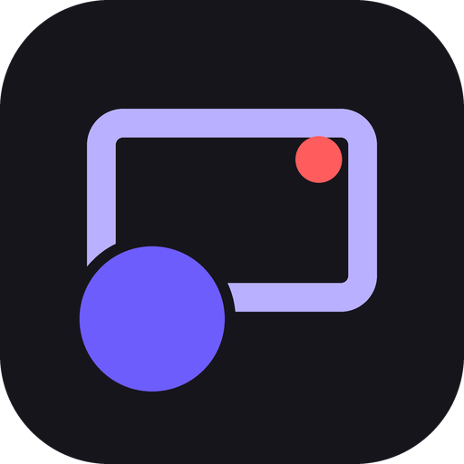
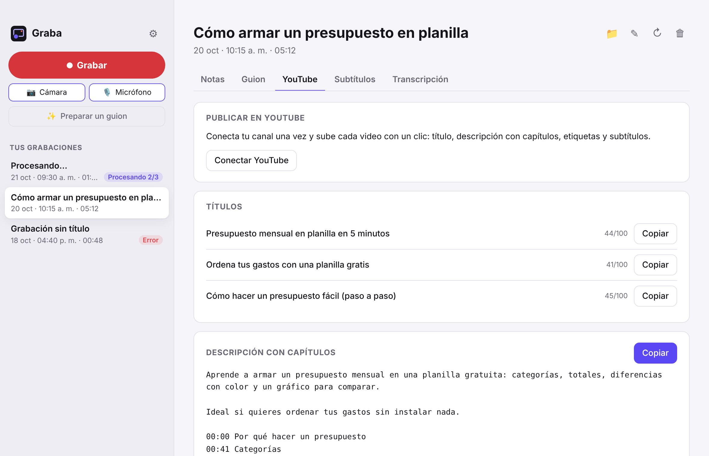

<p align="center"></p>

<h1 align="center">Graba</h1>

<p align="center"><b>Graba tu pantalla con tu cámara. Tu IA escribe notas, un guion para YouTube, títulos, una descripción con capítulos y subtítulos.</b><br>
Gratis, open source y sin fines de lucro. Mac, Windows y Linux. Todo pasa en tu computador.</p>

<p align="center"><a href="https://github.com/graba-app/graba/releases/latest"><b>Descargar</b></a> · <a href="https://graba-app.github.io/graba/"><b>Página</b></a> · <a href="#instalar">Instalar</a> · <a href="https://github.com/graba-app/graba/wiki">Wiki</a> · <a href="https://github.com/graba-app/graba/discussions">Comunidad</a> · <a href="CONTRIBUTING.md">Cómo aportar</a> · <a href="#licencia--license">English</a></p>

<p align="center"><picture><source srcset="docs/img/app-oscuro.jpg" media="(prefers-color-scheme: dark)"></picture></p>

---

## Qué hace

1. **Prepara el guion (opcional).** Cuéntale a tu IA la idea y cuánto debe durar. Suma tu presentación (PDF, PowerPoint, Word…).
   Tu IA escribe lo que vas a decir, con el largo justo.
2. **Graba.** Elige qué grabar: toda la pantalla, una ventana, un área o **solo la cámara**.
   - La cámara puede ser un círculo, cuadrada, horizontal o vertical, del tamaño que quieras.
   - Eliges qué cámara y qué micrófono usar.
   - Puedes sumar **el sonido del Mac** (o del computador, en Windows).
   - Puedes **pausar y reanudar**. El video no queda con un hueco.
   - El **teleprompter** avanza solo. No sale en el video, igual que la barra de controles.
   - **Atajos globales:** ⌃⌥⌘R empieza o termina, y ⌃⌥⌘P pausa. En Windows y Linux son Ctrl+Alt+Shift+R y Ctrl+Alt+Shift+P.
3. **Transcribe en tu computador** con whisper.cpp. Nada se sube a ningún servidor.
4. **Tu propia IA** (Claude Code, Codex o Gemini/Antigravity, con tu cuenta) escribe:
   - **Notas:** el resumen y los puntos clave.
   - **Guion para YouTube:** gancho, introducción, desarrollo (con qué mostrar) y cierre. Puedes mandarlo al teleprompter para
     grabar de nuevo.
   - **Para publicar:** 3 títulos, una descripción con **capítulos** y etiquetas. Los capítulos tienen tiempos reales y el primero
     está en 00:00, como pide YouTube.
   - **Subtítulos** `.srt`, listos para subir.
5. **Recorta el inicio y el final** («eh… ya, ¿se escucha?»). La transcripción, los subtítulos y los capítulos se corren solos. El
   original queda guardado para volver a él.
6. **Corrige con tus palabras**, por ejemplo: «dice Grava y es Graba». Tu IA lo arregla en todo, también en los subtítulos, y lo
   aprende.
7. **Directo a YouTube (en camino).** Conectas tu canal. Graba sube el video con título, capítulos, etiquetas y subtítulos, o al
   terminar.

Todo queda en `~/Graba`, con una carpeta por grabación. Son archivos normales: los puedes abrir, copiar o usar en tus scripts.

Graba **se actualiza sola**. Revisa al abrirse y cada 6 horas, y te avisa dentro de la app.

Cerrar la ventana no cierra Graba. La app queda en la **barra de menú** del Mac (sin ocupar el Dock) o en la **bandeja** de Windows
y Linux. Desde ahí puedes grabar, abrir la ventana o abrir la carpeta de grabaciones.

### Open source y sin fines de lucro

Graba no es una empresa. No hay versión de pago, anuncios, inversionistas ni datos que vender. Es gratis para siempre. El código es
abierto (AGPL-3.0) y la hacemos entre todos. ¿Quieres sumarte? Lee [CONTRIBUTING.md](CONTRIBUTING.md).

## Instalar

### Mac (chip Apple, macOS 15 o más nuevo)

**Con un comando:**
1. Abre la Terminal.
2. Ejecuta: `curl -fsSL https://raw.githubusercontent.com/graba-app/graba/main/instalar.sh | bash`

**Descargando:**
1. Descarga [`Graba-macOS.zip`](https://github.com/graba-app/graba/releases/latest/download/Graba-macOS.zip).
2. Arrastra Graba a Aplicaciones.
3. Si macOS dice que no pudo verificarla (todavía no tiene firma de Apple), ve a Ajustes del Sistema → Privacidad y seguridad →
   **Abrir igualmente**.

### Windows y Linux (la misma interfaz)

| | Con un comando | Descargando |
|---|---|---|
| 🪟 **Windows** | `irm https://raw.githubusercontent.com/graba-app/graba/main/instalar.ps1 \| iex` (PowerShell) | [`Graba-Windows.exe`](https://github.com/graba-app/graba/releases/latest/download/Graba-Windows.exe). Si aparece «Windows protegió tu PC», toca **Más información → Ejecutar de todas formas** |
| 🐧 **Linux** | `curl -fsSL https://raw.githubusercontent.com/graba-app/graba/main/instalar.sh \| bash` (sin sudo) | [`Graba-Linux.AppImage`](https://github.com/graba-app/graba/releases/latest/download/Graba-Linux.AppImage). Necesita FUSE: `sudo apt install libfuse2` |

Los comandos hacen esto:
1. Bajan la última versión.
2. Verifican su huella SHA-256.
3. La instalan solo para tu usuario.
4. La abren.

Requisitos: Windows 10 u 11 de 64 bits, o Linux x86_64 (Ubuntu 18.04+, Debian, Fedora…). No necesitas Python ni ffmpeg: vienen
dentro de la app.

En Windows y Linux, la transcripción usa el procesador (sin tarjeta gráfica). Por eso recomendamos el modelo «Liviano».

En Windows, la barra de controles no sale en el video. En Linux sí sale: no hay forma de ocultarla. Con Wayland, el sistema pregunta
qué pantalla compartir ([ayúdanos a probarla](https://github.com/graba-app/graba/issues)).

La primera vez, Graba hace tres cosas:
1. Te ayuda a elegir tu IA ([cómo instalarla](https://graba-app.github.io/graba/ia.html)).
2. Descarga el transcriptor (una sola vez).
3. Pide los permisos de pantalla, cámara y micrófono.

### Permisos e internet

- **Permisos en Mac:** Grabación de pantalla, Cámara y Micrófono. macOS los pregunta la primera vez. El Llavero, solo si conectas
  YouTube.
- **Permisos en Windows:** Graba respeta tus interruptores de privacidad de cámara y micrófono.
- **Permisos en Linux:** Graba no pide nada.
- **Atajos globales:** no piden el permiso de Accesibilidad.
- **Internet:**
  - GitHub, al abrir y cada 6 horas, para saber si hay una versión nueva. La versión se baja de sus Releases, con su huella.
  - Hugging Face, una vez, para el transcriptor.
  - YouTube, solo si conectas tu canal.
  - Tu IA habla con su proveedor, con tu cuenta.

Nada más. Graba no tiene servidores propios ni analítica.

## Formato de las grabaciones

```
~/Graba/
  2026-10-20 1015 - Cómo armar un presupuesto/
    video.mp4            # pantalla + burbuja de la cámara + micrófono (H.264 / AAC)
    grabacion.md         # todo el texto (abajo)
    subtitulos.srt       # subtítulos con tiempos
    transcripcion.json   # lo que dijo whisper, sin marcas ni frases inventadas ({"transcription": [{"offsets": {"from": ms, "to": ms}, "text": "…"}]})
    meta.json            # {"inicio": "2026-10-20T10:15:00", "duracion_seg": 312, "recortes": [{"inicio": 12.5, "fin": 300}]}
    estado.json          # {"estado": "procesando" | "lista" | "error", "paso", "total", "texto", "error"}
    youtube.json         # si se subió: {"estado": "subiendo" | "lista" | "error", "pct", "id", "url", "privacidad"}
    .original/           # solo si la recortaste: el video y los textos de antes del primer recorte (para «Volver al original»)
  .graba/                # configuración y modelos (no lo toques a mano: se cambia en Ajustes)
```

`grabacion.md` tiene esta forma. Los títulos de sección siempre van en español, aunque el contenido esté en otro idioma:

```markdown
---
fecha: 2026-10-20
hora: 10:15
duracion_seg: 312
titulo: "Cómo armar un presupuesto"
ia: claude
youtube: https://youtu.be/…  # solo si se subió desde Graba
tags: [graba]
---
# Cómo armar un presupuesto

## Resumen
## Notas
## Guion para YouTube
### Gancho / ### Introducción / ### Desarrollo / ### Cierre
## Para publicar
### Títulos
### Descripción
### Capítulos
00:00 Inicio
01:05 …
### Etiquetas
## Transcripción
[00:00] Hola, hoy les muestro…
```

## Desarrollo

```bash
git clone https://github.com/graba-app/graba ~/Developer/graba   # no en ~/graba: choca con ~/Graba (datos)
cd ~/Developer/graba && bash build.sh                             # compila e instala en ~/Applications
bash pruebas/correr.sh                                            # pruebas (interfaz con Playwright)
cd ui && python3 -m http.server 8765                              # interfaz en el navegador con datos ficticios
```

La app nativa sale de [Pieza](https://github.com/pieza-app/pieza): las piezas «host-mac» (Mac) y «host-escritorio» (Windows y
Linux, con Electron). Esas piezas traen la ventana, el puente, la config y los scripts con límite de tiempo. Graba suma lo suyo:
grabar, la barra y los flotantes, la barra de menú o la bandeja, los atajos y el recorte.

Graba todavía no usa «host-tauri», el host nuevo de Pieza. Antes necesita un ayudante en Swift para capturar la pantalla y el
audio en el Mac.

La guía completa para personas y para IAs de programación está en [`AGENTS.md`](AGENTS.md).

## Comunidad

- Preguntas, ideas y lo que armes con tus grabaciones: [Discussions](https://github.com/graba-app/graba/discussions).
- Para aportar, con o sin programar: [CONTRIBUTING.md](CONTRIBUTING.md).
- Graba es hermana de [Minuta](https://github.com/minuta-app/minuta), que hace lo mismo para reuniones.

## Componentes de terceros

Graba incluye estos programas aparte, sin modificarlos: [whisper.cpp](https://github.com/ggml-org/whisper.cpp) (MIT),
[Python](https://github.com/astral-sh/python-build-standalone) (PSF) y, en Windows y Linux, [Electron](https://www.electronjs.org/) (MIT)
y [FFmpeg](https://ffmpeg.org/) (GPL, binarios estáticos de [ffmpeg-static](https://github.com/eugeneware/ffmpeg-static); su código fuente
está en [ffmpeg.org](https://ffmpeg.org/download.html)). Cada descarga se verifica con una huella SHA-256 fija
(`escritorio/herramientas/preparar.sh`).

🔒 ¿Encontraste una falla de seguridad? Avísanos en privado: [SECURITY.md](SECURITY.md). · Security issues: please report them privately ([SECURITY.md](SECURITY.md)).

## Licencia / License

[AGPL-3.0](LICENSE). Desde la 0.2.0, Graba es AGPL-3.0; las versiones publicadas hasta la 0.1.0 siguen bajo MIT.
*Starting with 0.2.0, Graba is AGPL-3.0; versions published up to 0.1.0 remain under MIT.*

**English:** Graba is a free, open-source, non-profit screen recorder for Mac, Windows and Linux, like Loom.
- Your own AI CLI prepares the script for a teleprompter. The teleprompter isn't recorded.
- After recording, your AI writes notes, titles, a description with chapters and subtitles.
- Transcription is local. Everything stays on your computer.
- Record the whole screen, a window, an area or just the camera. The camera can have any shape. Add your mic and, if you want, the
  Mac's sound.
- Pause and resume without gaps. Use global shortcuts: ⌃⌥⌘R / ⌃⌥⌘P, or Ctrl+Alt+Shift+R / P on Windows and Linux.
- Trim the start and the end. The transcript, the subtitles and the chapters shift on their own.
- Closing the window doesn't quit Graba. It stays in the Mac's menu bar (not in the Dock) or in the Windows and Linux tray.

**Install:** Mac and Linux `curl -fsSL https://raw.githubusercontent.com/graba-app/graba/main/instalar.sh | bash` · Windows
(PowerShell) `irm https://raw.githubusercontent.com/graba-app/graba/main/instalar.ps1 | iex` · or the
[latest release](https://github.com/graba-app/graba/releases/latest).

**Permissions:** on Mac, Screen Recording, Camera and Microphone. The Keychain, only if you connect YouTube.
**Internet:** GitHub for updates, Hugging Face once for the transcriber, and YouTube only if you connect your channel. Your AI
talks to its provider with your account.

Questions and ideas are welcome in [Discussions](https://github.com/graba-app/graba/discussions), in English or Spanish.

---

[](https://pieza-app.github.io/pieza/) · Las piezas comunes (tu IA, idiomas, actualizaciones…) viven en [Pieza](https://github.com/pieza-app/pieza).
